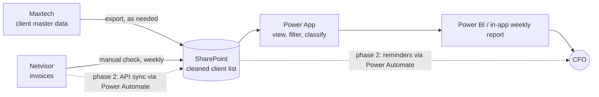

# Monthly Invoicing Tracker (Power Platform)

> A Power Apps solution that gives a CFO a clear weekly view of invoicing progress, replacing a manual cross-checking process and a messy SharePoint list.

**Status:** Discovery and design (v1 in planning)
**Stack:** Power Apps, SharePoint (v1 data source), Power Automate, Power BI *(see [Decision log](#decision-log))*
**Role:** Freelance consultant (requirements, design, build, handover)

---

## 1. Business context

The company must invoice every client each month and aims for **100% of invoices done by month end**. Today the CFO tracks this manually:

- The list of clients to invoice lives in an Excel file / SharePoint list, fed by the client management app (Maxtech).
- Invoices that were actually created live in the accounting system (Netvisor).
- Netvisor cannot produce a "clients not yet invoiced this month" list, because it only knows what exists, not what is missing.
- The CFO therefore compares the two by hand, every week.
- The existing SharePoint list was inherited from the previous CFO and wants to personalize it.

## 2. Problem statement

> The CFO needs to see, each week, which clients have been invoiced this month and which have not, so she can monitor progress toward 100% and chase whatever is blocking the remaining invoices.

## 3. Stakeholder discovery

Answers from the CFO (anonymised), collected before any building started.

| Question | Answer |
|---|---|
| What do you do with this report when you open it? | Monitor invoicing progress weekly; see what is still missing. |
| How do you know today who should be invoiced? | An Excel list, sourced from Maxtech. It does not show invoice status. |
| Where do you check what was invoiced? | Netvisor, manually. It has no "invoiced / not invoiced" filter. |
| Does it need to be live? | No. Weekly is fine. |
| Look only, or also write? | Initially view only. After further discussion: she also wants to classify clients and follow up on missing information. |
| What is wrong with the current SharePoint? | Inherited from the previous and wants clarity and order. |

**Facts established**

- Every client has a **unique client ID, identical across Maxtech, Netvisor and SharePoint**. This removes the biggest matching risk (name variations).
- The SharePoint list is edited mainly by the CFO, but anyone with access can edit it.

## 4. Scope

### Version 1 (in scope)
- [ ] Clean, restructured data foundation (replacing the messy list)
- [ ] Classification of clients: **automated invoicing** vs **manual invoicing**
- [ ] Monthly invoice status per client (invoiced / not invoiced), updated manually in v1
- [ ] Weekly progress report with filters (by week, by client, by invoicing type, by status)
- [ ] Documentation and handover

### Phase 2 (planned, not in v1)
- [ ] Reminder system: flag clients missing information (e.g. hourly rate) and notify the right person
- [ ] Automatic sync from Netvisor (API) replacing manual status updates

### Out of scope
- Changing how Netvisor or Maxtech work
- Creating invoices from the app

## 5. Assumptions and open questions

| # | Question | Status | Answer |
|---|---|---|---|
| 1 | Does each client get exactly one invoice per month? | Open | |
| 2 | Is the Excel list identical to Maxtech, or edited by hand? | Open | |
| 3 | Is the monthly client list frozen at month start, or can clients join or leave mid-month? | Open | |
| 4 | Does "invoiced" mean created in Netvisor or sent to the client? | Open | |
| 5 | Who updates invoice status in v1, and how often? | Open | |
| 6 | Does the Netvisor plan allow API access, and who issues credentials? | Open (phase 2) | |
| 7 | Is there a policy on where financial data may be stored? | Open | |

## 6. Data flow

> Draft. Verify against the real process and update after each discovery step.



Solid arrows are v1. Dotted arrows are phase 2.

## 7. SharePoint audit

`TODO`: Before building, document what you found in the existing SharePoint.

- Lists and libraries that exist, and which are actually used:
- Duplicate or inconsistent records found:
- Columns that are unused, unclear, or duplicated:
- Data quality issues (blanks, free-text where a choice list is needed, inconsistent formats):
- Who edits it and how:

## 8. Data model

`TODO`: Do not copy the old columns as they are. For each column, decide: keep, rename, merge, split, or drop. Then design the target tables.

**Column review (old list to new design)**

| Old column | Decision (keep / rename / split / drop) | Reason |
|---|---|---|
| | | |

**Target tables**

`TODO`: Think about what describes a *client* (changes rarely) versus what describes a *client's invoicing for one month* (changes every month). Add an ER diagram here when ready.

## 9. Decision log

Short records of design choices and the reasoning behind them.

| # | Decision | Options considered | Choice | Why |
|---|---|---|---|---|
| 1 | Where does v1 data live? | SharePoint list, Dataverse, SQL Server | `TODO` | `TODO`: consider delegation limits, relationships between tables, security, licensing, and the effort to migrate later |
| 2 | App or report only? | Power BI only, Power App | Power App | The CFO needs to classify clients and follow up on missing information, not just view data |
| 3 | Reminder tool | Power Automate | Power Automate | Scheduled and triggered flows suit recurring notifications |

## 10. Security and governance

`TODO`: Who can view, who can edit, and who can change client classifications? Currently anyone can edit the SharePoint list. What should change?

## 11. Roadmap

| Phase | Deliverable | Target |
|---|---|---|
| Discovery | Requirements, audit, data flow | Week 1 |
| Design | Data model, screens, decision log | Week 1 |
| Build | Data foundation, app, weekly report | Week 2 |
| Handover | User guide, documentation, export of the solution | Week 2 |
| Phase 2 | Reminders, Netvisor sync | TBD |

## 12. Repository structure

```
/docs
  requirements.md
  stakeholder-answers.md
  data-flow.md
  sharepoint-audit.md
  data-model.md
  user-guide.md
/solution          <- exported Power Platform solution (unpacked with pac)
/screenshots
README.md
```

## 13. Learning log

`TODO`: One or two lines per work session: what you learned, what surprised you, what you would do differently.

| Date | Note |
|---|---|
| | |

---

*All client and company information has been anonymised. No real data is stored in this repository.*
